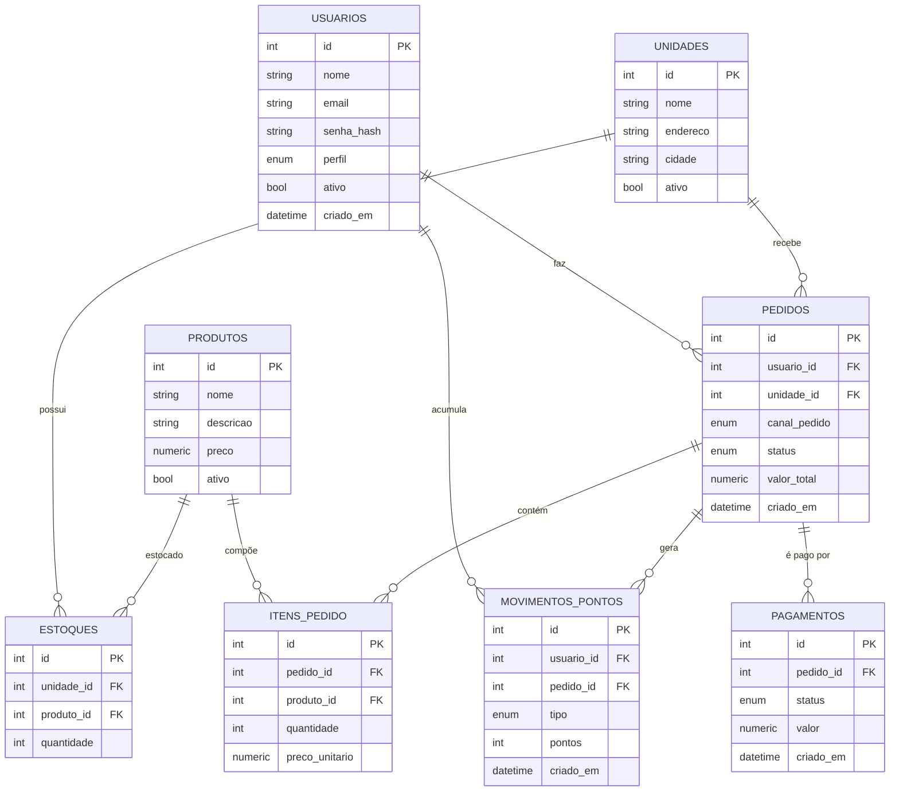

# API Raízes do Nordeste — Back-end

Back-end do Projeto Multidisciplinar (Trilha Back-End): rede de lanchonetes com
pedidos multicanal (**APP, TOTEM, BALCAO, PICKUP, WEB**), autenticação JWT,
regra de perfil, pagamento mock e programa de fidelidade.

## Stack

- **Python 3.14** + **FastAPI** (Swagger automático em `/docs`)
- **SQLAlchemy 2.x** + **SQLite** (troca para Postgres só mudando a `DATABASE_URL`)
- **Alembic** (migrations)
- **PyJWT** + **bcrypt** (token e hash de senha)
- **Pydantic v2** (validação/contratos)

## Pré-requisitos

- Python 3.12+
- Git

## Como configurar

```bash
# 1. Criar e ativar o ambiente virtual
python -m venv .venv
.venv\Scripts\activate            # Windows

# 2. Instalar dependências
pip install -r requirements.txt

# 3. Copiar variáveis de ambiente
copy .env.example .env            # Windows
```

## Como rodar

```bash
# aplica as migrations
.venv\Scripts\alembic upgrade head

# popula dados de exemplo (gerente, unidade, produtos e estoque)
.venv\Scripts\python seed.py

# sobe a API
.venv\Scripts\python -m uvicorn app.main:app --reload
```

- API: http://127.0.0.1:8000
- **Swagger:** http://127.0.0.1:8000/docs
- Health check: http://127.0.0.1:8000/health

## Credenciais do seed

| Perfil | E-mail | Senha |
|---|---|---|
| GERENTE | `gerente@raizes.com` | `gerente123` |

> Crie um usuário CLIENTE pelo `POST /auth/register` para testar a regra de perfil.

## Endpoints

| Método | Rota | Quem pode | Descrição |
|---|---|---|---|
| GET | `/health` | público | Verificação da API |
| POST | `/auth/register` | público | Cadastro (nasce como CLIENTE) |
| POST | `/auth/login` | público | Login, retorna o token JWT |
| POST | `/unidades` | GERENTE, ADMIN | Cria unidade |
| GET | `/unidades` | autenticado | Lista unidades |
| POST | `/produtos` | GERENTE, ADMIN | Cria produto |
| GET | `/produtos` | autenticado | Lista produtos |
| POST | `/estoques` | GERENTE, ADMIN | Define/atualiza estoque |
| POST | `/pedidos` | autenticado | Cria pedido (com `canalPedido`) |
| GET | `/pedidos?canalPedido=TOTEM` | autenticado | Lista/filtra pedidos por canal |
| POST | `/pedidos/{id}/pagamento` | dono ou gestor | Pagamento mock (aprova/recusa) |

## Fluxo principal (MVP)

```
POST /pedidos            -> status AGUARDANDO_PAGAMENTO
POST /pedidos/1/pagamento {"aprovado": true}
   |- cria Pagamento APROVADO
   |- pedido.status = EM_PREPARO
   \- credita pontos de fidelidade (MovimentoPontos)
```

### Exemplo rápido (curl)

```bash
# 1. login
curl -X POST http://127.0.0.1:8000/auth/login \
  -H "Content-Type: application/json" \
  -d "{\"email\":\"gerente@raizes.com\",\"senha\":\"gerente123\"}"

# 2. criar pedido (troque <TOKEN> e use canalPedido)
curl -X POST http://127.0.0.1:8000/pedidos \
  -H "Authorization: Bearer <TOKEN>" -H "Content-Type: application/json" \
  -d "{\"unidade_id\":1,\"canalPedido\":\"TOTEM\",\"itens\":[{\"produto_id\":1,\"quantidade\":2}]}"

# 3. pagar
curl -X POST http://127.0.0.1:8000/pedidos/1/pagamento \
  -H "Authorization: Bearer <TOKEN>" -H "Content-Type: application/json" \
  -d "{\"aprovado\":true}"
```

## Enums de domínio

- **Perfil:** `CLIENTE`, `GERENTE`, `COZINHA`, `ADMIN`
- **canalPedido:** `APP`, `TOTEM`, `BALCAO`, `PICKUP`, `WEB`
- **StatusPedido:** `AGUARDANDO_PAGAMENTO`, `EM_PREPARO`, `PRONTO`, `ENTREGUE`, `CANCELADO`
- **StatusPagamento:** `PENDENTE`, `APROVADO`, `RECUSADO`
- **TipoMovimento:** `ACUMULO`, `RESGATE`

## Erro JSON padronizado

Todas as respostas de erro seguem o mesmo formato:

```json
{
  "erro": {
    "status": 403,
    "mensagem": "Acesso negado para o seu perfil"
  }
}
```

Erros de validação (422) incluem `detalhes`:

```json
{
  "erro": {
    "status": 422,
    "mensagem": "Dados de entrada invalidos",
    "detalhes": [
      { "campo": "body.canalPedido", "mensagem": "Input should be 'APP', 'TOTEM', 'BALCAO', 'PICKUP' or 'WEB'" }
    ]
  }
}
```

## Logs / auditoria

- Cada requisição é registrada via middleware: **método, rota, status e tempo (ms)**.
- A trilha de auditoria de negócio fica nas tabelas `pagamentos` e `movimentos_pontos`.

## DER (Diagrama Entidade-Relacionamento)



## Estrutura do projeto (camadas)

```
app/
  core/            configuracao (settings, .env, seguranca/JWT, logging)
  domain/          entidades (models) e enums
  infrastructure/  banco (engine, sessao, Base)
  api/
    deps.py        dependencias (usuario atual, regra de perfil)
    errors.py      erro JSON padronizado
    middleware.py  log de requisicoes
    routers/       auth, catalogo, pedido
    schemas/       contratos Pydantic
  main.py          criacao da aplicacao FastAPI
migrations/        arquivos gerados pelo Alembic
postman/           colecao para importar no Postman/Insomnia
seed.py            dados de exemplo
```

## Coleção de testes

Importe o arquivo `postman/raizes-do-nordeste.postman_collection.json` no
Postman ou Insomnia. São **16 requisições** em 4 pastas (Auth, Catalogo,
Pedidos, Erros), com testes automáticos de status e captura de token.

## Migrations (Alembic)

```bash
.venv\Scripts\alembic revision --autogenerate -m "descricao"
.venv\Scripts\alembic upgrade head
```

## Qualidade de código

```bash
.venv\Scripts\python -m ruff check app seed.py
.venv\Scripts\python -m ruff format app seed.py
```

## Repositório

- GitHub: https://github.com/fernandobirkauler/projeto_backend
- Swagger local: http://127.0.0.1:8000/docs
- Coleção: `postman/raizes-do-nordeste.postman_collection.json`
